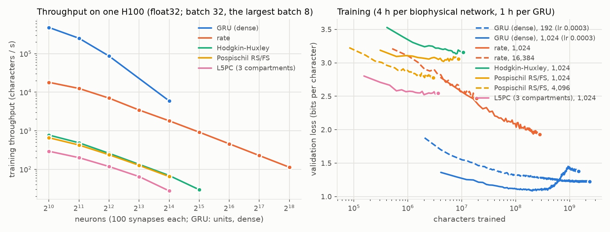

# Character-level language models of biophysical neurons

A prototype: recurrent networks of biophysical neuron models, simulated with
jaxley-pytorch, trained as character-level language models on TinyStories by
backpropagation through the simulator.

## Data

[karpathy/tinystories-gpt4-clean](https://huggingface.co/datasets/karpathy/tinystories-gpt4-clean)
(revision `0397e27`, in the Hugging Face home `~/huggingface`): the GPT-4 stories of
TinyStories (Eldan & Li, 2023), cleaned to 74 ASCII characters. `prepare_data.py`
tokenizes it at the character level: the 74 characters and an end-of-story token, a
vocabulary of 75. The dataset's suggested splits give 2,712,634 training stories
(2.18 billion tokens), 10,000 validation and 10,000 test stories (8.0 and 8.1 million
tokens). The token files are in
`/nrs/scicompsoft/orhane/probes/jaxley_pytorch/language_modeling/data`.

```bash
python -I prepare_data.py --parquet ~/huggingface/hub/datasets--karpathy--tinystories-gpt4-clean/snapshots/0397e27157956705a0260709da3095bb9c43d6a7/tinystories_gpt4_clean.parquet --out <data dir>
```

## Models (`models.py`)

Every network has `n` neurons, 80% of them excitatory. Every neuron receives 100
synapses, 80 from random excitatory and 20 from random inhibitory neurons (no
autapses), and Dale's law holds: all synapses of a neuron have the sign of its type.
The trainable synaptic weights are `softplus(theta) * scale`, so they cannot change
sign. The synapses are created in order of the postsynaptic neuron (its excitatory
inputs first), the layout for which jaxley_pytorch steps them with fused GPU kernels
(see "Throughput" below).

Every character is presented for 5 ms of network time: a learned vector of input
currents (one per neuron, as a current density), constant over the 5 ms, is injected
into every neuron. The readout is a linear map from each neuron's voltage, averaged
over the 5 ms, to the 75 next-character logits. The network state carries over from
one character to the next.

| model | neuron | compartments per neuron | state variables per neuron | synapses | solver step |
|---|---|---|---|---|---|
| `rate` | passive membrane (leak, 10 ms time constant) | 1 | 1 | current-based, sigmoid of the presynaptic voltage | 0.5 ms |
| `hh` | Hodgkin-Huxley | 1 | 4 | conductance-based, first-order kinetics | 0.025 ms |
| `pospischil` | Pospischil et al. (2008): regular-spiking excitatory (Na, K, M-type K, leak), fast-spiking inhibitory (Na, K, leak) | 1 | 5 (exc.), 4 (inh.) | as `hh` | 0.025 ms |
| `l5pc` | the Jaxley paper's RNN unit (Fig. 4): apical, soma and basal compartments with L5PC channels; synapses from the soma onto the apical compartment, input into the basal one, readout from the soma | 3 | 20 | as `hh` | 0.025 ms |
| `gru` | a conventional GRU (dense, not biophysical), for reference | - | - | - | - |

The spiking models' synapses have reversal potentials of 0 mV (excitatory) and -80 mV
(inhibitory), a rise rate of 1/ms and decay time constants of 5 and 10 ms, and release
transmitter when the presynaptic voltage exceeds -20 mV (slope 2 mV), i.e. at spikes.
The input scales were set so that the untrained networks fire at 25-45 Hz when driven
by text (`train.py --mode activity`).

The two synapse models were written for this example and are now part of
jaxley_pytorch (`jaxley_pytorch.synapses`, not in Jaxley):

* **Rate synapses.** Jaxley's `TanhRateSynapse` multiplies the weight by a tanh of the
  presynaptic voltage, which is negative below its offset, so an excitatory synapse
  would then inhibit. `SigmoidRateSynapse` uses a sigmoid (a non-negative rate)
  instead, so the weight's sign is the synapse's sign.
* **Spiking synapses.** `KineticSynapse` is the standard first-order kinetic model
  (Destexhe, Mainen & Sejnowski, 1994), with a bounded rise rate.

Two float32 problems of the library, inherited from Jaxley, surfaced here and have
since been fixed in `jaxley_pytorch` (`tests/test_float32_safety.py`): the HH and
Pospischil channels (and jaxley-mech's retinal ganglion cell channels) computed rates
`x / (exp(x) - 1)` that are 0/0 at one voltage each (e.g. -40 mV for HH's m gate),
which float32 voltages hit now and then (the NaN then spreads through the network);
and `IonotropicSynapse` computed its time constant as `(1 - s_inf) / k_minus`, which
is 0, with a NaN gradient, once a steep release saturates (`s_inf` rounds to 1 during
a spike).

## Training (`train.py`)

Truncated backpropagation through time: 32 parallel streams through the training
text; every step simulates the next 32 characters (160 ms) of every stream from the
state the previous step ended in and backpropagates through those 32 characters.
Every character's simulation is checkpointed (recomputed in the backward pass). Adam
(learning rate 3e-3, the readout's scaled by 1024 / n for larger networks), the
gradient norm of every parameter tensor clipped at 1, float32. On the GPU, the whole
training step (simulation, loss, backward pass, Adam) is compiled (`torch.compile`)
and captured in a CUDA graph.

```bash
python train.py --mode train --model pospischil --n 1024 --hours 4 --eval-every 100 --out <dir>
python train.py --mode bench --model hh --n 4096 --out <dir>       # throughput only
python train.py --mode sample --out <dir of a training run>        # generate text
```

## Results



### Throughput

One NVIDIA H100 (80 GB), float32, 32 streams of 32 characters per step (1,024
characters), 5 ms of network time per character (10 solver steps for `rate`, 200 for
the spiking models); `train.py --mode bench`. Rows with batch 8 are the largest
networks of their model, which only fit with 8 streams and checkpointing inside every
character's simulation. 100M characters are about 100,000 steps of 1,024 characters.

| model | neurons | synapses | solver step (ms) | batch | ms per solver step | characters / s | days per 100M characters | peak GPU memory (GB) | GPU |
|---|---|---|---|---|---|---|---|---|---|
| gru | 1,024 | - | - | 32 | - | 477,749 | 0.00242 | 0.4 | H100 |
| gru | 2,048 | - | - | 32 | - | 250,845 | 0.00461 | 0.9 | H100 |
| gru | 4,096 | - | - | 32 | - | 86,545 | 0.0134 | 2.9 | H100 |
| gru | 16,384 | - | - | 32 | - | 5,939 | 0.195 | 40.0 | H100 |
| rate | 1,024 | 102,400 | 0.5 | 32 | 0.18 | 18,013 | 0.0643 | 0.2 | H100 |
| rate | 2,048 | 204,800 | 0.5 | 32 | 0.26 | 12,486 | 0.0927 | 0.4 | H100 |
| rate | 4,096 | 409,600 | 0.5 | 32 | 0.46 | 7,004 | 0.165 | 0.8 | H100 |
| rate | 8,192 | 819,200 | 0.5 | 32 | 0.93 | 3,441 | 0.336 | 1.5 | H100 |
| rate | 16,384 | 1,638,400 | 0.5 | 32 | 1.77 | 1,806 | 0.641 | 3.0 | H100 |
| rate | 32,768 | 3,276,800 | 0.5 | 32 | 3.49 | 917 | 1.26 | 6.1 | H100 |
| rate | 65,536 | 6,553,600 | 0.5 | 32 | 7.01 | 457 | 2.54 | 12.1 | H100 |
| rate | 131,072 | 13,107,200 | 0.5 | 32 | 14.13 | 226 | 5.11 | 24.2 | H100 |
| rate | 262,144 | 26,214,400 | 0.5 | 32 | 28.40 | 113 | 10.3 | 48.4 | H100 |
| hh | 1,024 | 102,400 | 0.025 | 32 | 0.21 | 771 | 1.5 | 3.6 | H100 |
| hh | 2,048 | 204,800 | 0.025 | 32 | 0.33 | 485 | 2.39 | 7.2 | H100 |
| hh | 4,096 | 409,600 | 0.025 | 32 | 0.62 | 259 | 4.48 | 13.9 | H100 |
| hh | 8,192 | 819,200 | 0.025 | 32 | 1.20 | 134 | 8.65 | 27.7 | H100 |
| hh | 16,384 | 1,638,400 | 0.025 | 32 | 2.33 | 69 | 16.8 | 55.2 | H100 |
| hh | 32,768 | 3,276,800 | 0.025 | 8 | 1.36 | 29 | 39.3 | 80.5 | H100 |
| pospischil | 1,024 | 102,400 | 0.025 | 32 | 0.24 | 658 | 1.76 | 3.8 | H100 |
| pospischil | 2,048 | 204,800 | 0.025 | 32 | 0.38 | 425 | 2.73 | 7.7 | H100 |
| pospischil | 4,096 | 409,600 | 0.025 | 32 | 0.67 | 238 | 4.86 | 14.8 | H100 |
| pospischil | 8,192 | 819,200 | 0.025 | 32 | 1.27 | 126 | 9.16 | 29.4 | H100 |
| pospischil | 16,384 | 1,638,400 | 0.025 | 32 | 2.48 | 65 | 17.9 | 58.8 | H100 |
| l5pc | 1,024 | 102,400 | 0.025 | 32 | 0.55 | 293 | 3.95 | 5.8 | H100 |
| l5pc | 2,048 | 204,800 | 0.025 | 32 | 0.80 | 200 | 5.8 | 11.7 | H100 |
| l5pc | 4,096 | 409,600 | 0.025 | 32 | 1.36 | 118 | 9.84 | 22.9 | H100 |
| l5pc | 8,192 | 819,200 | 0.025 | 32 | 2.48 | 64 | 18 | 45.6 | H100 |
| l5pc | 16,384 | 1,638,400 | 0.025 | 8 | 1.46 | 27 | 42.2 | 65.1 | H100 |

* **The synapse step.** With the synapses ordered by postsynaptic neuron, jaxley_pytorch
  sums the currents of every neuron's synapses instead of scattering them with atomic
  adds, and on CUDA it simulates both synapse models with fused Triton kernels
  (`jaxley_pytorch/kernels/synapse_step.py`): per solver step, one forward kernel
  (synapse states, presynaptic voltages, the current terms summed per neuron) and one
  backward kernel, with only the synapse states kept for the backward pass. At 1,024
  neurons (100k synapses, 32 streams; forward pass, recomputation and backward pass
  together) a solver step takes 0.18 ms (`rate`), 0.21 ms (Hodgkin-Huxley), 0.24 ms
  (Pospischil) and 0.55 ms (L5PC). The point-neuron networks update 14-18 billion
  synapses per second at 1,024 neurons and more in larger networks (`rate` 30 billion
  from 4,096 neurons on, Hodgkin-Huxley and Pospischil 21-22 billion at 16,384). The
  three-compartment L5PC units with ten channel types cost 2.6 times as much as
  Hodgkin-Huxley point neurons.
* Characters per second are set by the solver steps per character: the rate model
  (0.5 ms steps) is 23-27x faster than Hodgkin-Huxley networks of the same size.
* **Largest networks on one H100**: `rate` 262,144 neurons (26M synapses) at batch 32
  (48 GB; the largest size tried); Hodgkin-Huxley 32,768 (batch 8); Pospischil 16,384
  (batch 32) and L5PC 16,384 (batch 8). 65,536 Hodgkin-Huxley neurons and 32,768
  Pospischil or L5PC neurons ran out of memory. Building a network takes about 18 ms
  per neuron (83 min for 262,144); compilation and graph capture 20 s to 32 min.
* **100,000 steps of 1,024 characters in under a week**: the rate model up to 65,536
  neurons (2.5 days; 131,072 take 5.1), Hodgkin-Huxley and Pospischil networks up to
  4,096 neurons (4.5 and 4.9 days), L5PC up to 2,048 (5.8 days).
* Of a solver step of the Hodgkin-Huxley network of 1,024 neurons (215 us of GPU time,
  `diagnose/profile_step.py`), the synapse kernels take 100 us; the rest are the
  channels, the voltage solve and about 60 small kernels (among them the backward pass
  of the recording, an `index` outside the compiled step, 16 us with a sort).

### Training

Four hours per biophysical network, one hour per GRU, learning rate 3e-3 unless noted
(`train.py --mode train`, validation on 8 chunks of 32 characters in 32 streams):

| model | neurons | learning rate | parameters | characters trained | hours | characters / s | train bpc (last 100 steps) | validation bpc |
|---|---|---|---|---|---|---|---|---|
| gru | 192 | 0.003 | 0.25M | 2,306.6M | 1.0 | 1,006,318 | 1.71 | 1.76 |
| gru | 192 | 0.001 | 0.25M | 2,310.7M | 1.0 | 1,013,921 | 1.54 | 1.61 |
| gru | 192 | 0.0003 | 0.25M | 2,361.9M | 1.0 | 1,027,258 | 1.13 | 1.23 |
| gru | 1,024 | 0.003 | 6.45M | 1,474.2M | 1.0 | 476,160 | 1.65 | 2.08 |
| gru | 1,024 | 0.001 | 6.45M | 1,477.8M | 1.0 | 478,655 | 1.37 | 1.59 |
| gru | 1,024 | 0.0003 | 6.45M | 1,477.5M | 1.0 | 478,975 | 1.33 | 1.38 |
| rate | 1,024 | 0.003 | 0.26M | 281.8M | 4.0 | 20,359 | 1.72 | 1.93 |
| rate | 16,384 | 0.003 | 4.10M | 18.9M | 4.0 | 1,806 | 2.15 | 2.47 |
| hh | 1,024 | 0.003 | 0.26M | 10.6M | 4.0 | 774 | 3.18 | 3.16 |
| pospischil | 1,024 | 0.003 | 0.26M | 8.7M | 4.0 | 650 | 3.05 | 3.06 |
| pospischil | 4,096 | 0.003 | 1.02M | 2.9M | 4.0 | 237 | 2.78 | 2.78 |
| l5pc | 1,024 | 0.003 | 0.26M | 3.7M | 4.0 | 291 | 2.39 | 2.54 |

The same models after the same number of characters (training loss in bits per
character, mean over the logging window), i.e. what they learn from equal data:

| model | neurons | learning rate | 0.5M | 1M | 2M | 5M | 50M |
|---|---|---|---|---|---|---|---|
| gru | 192 | 0.003 | 1.85 | 1.71 | 1.57 | 1.49 | 1.67 |
| gru | 192 | 0.0003 | 2.55 | 2.16 | 1.84 | 1.61 | 1.33 |
| gru | 1,024 | 0.0003 | 1.79 | 1.59 | 1.40 | 1.28 | 1.09 |
| rate | 1,024 | 0.003 | 3.21 | 3.11 | 2.96 | 2.67 | 2.08 |
| rate | 16,384 | 0.003 | 3.24 | 3.06 | 2.91 | 2.59 | - |
| hh | 1,024 | 0.003 | 3.49 | 3.36 | 3.25 | 3.23 | - |
| pospischil | 1,024 | 0.003 | 3.10 | 3.09 | 3.06 | 3.04 | - |
| pospischil | 4,096 | 0.003 | 2.93 | 2.88 | 2.74 | - | - |
| l5pc | 1,024 | 0.003 | 2.57 | 2.43 | 2.39 | - | - |

* All biophysical networks learn. Per character of data, the three-compartment L5PC
  network learns fastest (2.43 bpc after 1M characters, vs 3.1-3.4 for the other
  networks of 1,024 neurons), and the 4,096-neuron Pospischil network beats the
  1,024-neuron one (2.74 vs 3.06 bpc after 2M characters). They remain far behind a
  GRU of the same parameter count (192 units: 1.7-2.2 bpc after 1M characters).
* In four hours the rate network of 1,024 neurons sees 282M characters, 27-76x more
  than the spiking networks of its size, and gets furthest (1.93 bpc); the one of
  16,384 neurons learns more per character (2.59 vs 2.67 bpc after 5M characters).
* The Hodgkin-Huxley and Pospischil networks of 1,024 neurons stop improving after
  about 2M characters (3.25 and 3.06 bpc at 2M, 3.23 and 3.04 at 5M): at this learning
  rate, which was not tuned for the biophysical networks, more data does not help them.
  For the GRUs, 3e-3 is too high beyond ~10M characters (the loss rises again) and
  3e-4 is best.

Samples (`train.py --mode sample`, temperature 0.8, after the prompt "Once upon a
time"; the first 200 characters of the first sample):

* GRU, 192 units (1.23 bpc): ". <end of story> Once upon a time, there was a little
  girl named Mary. She smiled and said, "Are you the pond is being quick." Tom and Sam
  said to Tom. Tim was so happy. He saw Tim and Lily and said,"
* rate, 1,024 (1.93 bpc): ", there was a read of new. You can playing in the park
  poties. Tim wanted to mean Tim went to the big ronce and toudell hop in the ofelcing
  it wourde." The bird saw a red blanck. They ablo could not m"
* L5PC, 1,024 (2.54 bpc): "d atung do fring frog norkyt, So, a bug smile mad came and
  he cat hardenthe nowan f ontet to help. They mech and the rinds and shiny. She they
  plare tole. Hime, theted to he said, "Whing im lanth in m"
* Pospischil, 4,096 (2.78 bpc): ", to sad ty tas te can itrte sow a said toy gandy day
  and osm and alde hit lovee fin tey poan to bead Maick and litell bo and the of loo ke
  hir big tole. Hik therwte stis the moks. She too la tilid d"
* Hodgkin-Huxley, 1,024 (3.16 bpc): ", to srd.ty was very n iout, youl. The k. The bay,
  be looook rith ld be toSe ans ant toy anthad toeed, cd cakt b e ithe jorpl rdog was a
  brg Her Itele a big, br tad the the The fe wabal lin a aol"

### What it took to make the spiking networks train

* **The solver step.** One neuron, a noisy current for 1 s, spikes compared with a
  0.0125 ms reference (`diagnose/dt_accuracy_v2.py` on /nrs):

  | model | step 0.1 ms | 0.05 ms | 0.025 ms |
  |---|---|---|---|
  | Hodgkin-Huxley: spikes (reference 44) | 38 | 62 | 44 |
  | Hodgkin-Huxley: median spike shift | 28 ms | 0.68 ms | 0.21 ms |
  | Pospischil RS: spikes (reference 33) | 33 | 33 | 33 |
  | Pospischil RS: median spike shift | 4.5 ms | 1.6 ms | 0.53 ms |

  (float32 and float64 gave the same spikes.) At 0.05 ms, the gradients through the
  recurrent spiking dynamics also grow far faster: the gradient norm of the input
  weights of the Pospischil network of 1,024 neurons over 16 characters is 1.1e6 at
  0.05 ms and 1.4e3 at 0.025 ms (0.56 without recurrent synapses;
  `diagnose/grad_norms.py`).
* **Clipping every parameter tensor's gradient on its own** (rather than all
  together), so that large gradients through the network dynamics do not scale down
  the readout's. After 150 steps of the Pospischil network of 1,024 neurons: 3.33 bpc
  (per tensor), 8.01 (all together; 3.76 after 120 steps, then it diverged), 3.34 (per
  tensor, and the gradient through the state also truncated every 8 characters).
* **The readout's learning rate scaled by 1024 / n**: with Adam, a logit moves by
  about the learning rate times n per step. After 150 steps, the rate network of
  8,192 neurons is at 3.44 bpc with the scaled learning rate and at 7.87 bpc without
  it (15.5 after 30 steps).

### Next steps

* Tune the learning rate (and a schedule) for the biophysical networks: the spiking
  networks of 1,024 neurons stop improving after about 2M characters at 3e-3.
* Train the larger networks (spiking networks of up to 16,384 neurons fit at batch 32
  on one H100) and for longer.
* The synapse kernels: the forward kernel reaches about 1 TB/s, as does the one
  `torch.compile` generates (its limit was not found; there was no access to the GPU's
  performance counters).
* The rest of the solver step: the backward pass of the recording (an `index` with a
  sort, 16 us per solver step) and many small kernels; and building large networks
  (18 ms per neuron).

All runs: `/nrs/scicompsoft/orhane/probes/jaxley_pytorch/language_modeling/v2`
(`bench`: throughput; `train`: training runs with `result.json`, `model.pt`,
`samples.json`; `ablation`; `calibrate`: activity of the untrained networks; `jobs`:
logs), the probes in `../diagnose` (profiler, solver step, gradient norms). Tables:
`summarize.py`; figure: `plot_results.py`.
